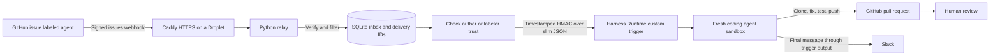

# A GitHub issue becomes a pull request on DigitalOcean

Label a small GitHub issue `agent` in your own demo repository. A webhook starts
a coding agent in DigitalOcean Harness Runtime; the tested path uses OpenCode.
The agent makes a change, runs tests, pushes a feature branch, and opens a PR.
Harness Runtime posts the agent's final summary to Slack. A person reviews the PR.
There are no issue comments, automated merges, or replies from Slack.

This example starts with a direct GitHub-to-trigger v0, then adds the relay.
The relay runs no model and needs no DigitalOcean API token.

## Try it in your own repositories

This repository contains the setup, relay and documentation. The separate
[shipping API demo](https://github.com/oconnoob/issue-to-pr-demo) contains an
intentional boundary bug. Create your own repository from that demo's **Use this
template** button, including **only its default branch**. Existing fix branches
and example PRs are evidence, not the starting code for your run. Keep your copy
private while testing the direct webhook path and configure your own DO and
Slack credentials. Adding a label to an upstream example issue is not a shared
agent service.

```bash
git clone https://github.com/oconnoob/issue-to-pr.git
cd issue-to-pr
if [ ! -f .env ]; then cp .env.example .env; fi
chmod 600 .env
```

Then follow step 1 below. For a self-contained copy without the separate demo
repository, use [examples/shipping-api](examples/shipping-api/) and the
[demo walkthrough](docs/demo.md).

## Reading guide

- [Demo walkthrough](docs/demo.md): a fresh private target, before/after curl
  requests and independent tests of the agent's PR using the [copyable app](examples/shipping-api/).
- [Environment values](docs/environment.md): where credentials come from and how
  to load them without committing them.
- [Slack installation](slack/README.md) and [app manifest](slack/manifest.yaml).
- [Setup questions](docs/setup-faq.md): GitHub UI labels, expired auth links,
  YAML imports, local tunnels and what the setup scripts actually create.
- [Authentication troubleshooting](docs/authentication.md): model access,
  account/team context and sandbox GitHub credentials.



## What was verified

Checked on **6 November 2026**, using DigitalOcean's public docs and the live
`doctl harness-runtime triggers list-providers` response. Local CLI: 2.1.0.

| Detail | Result |
| --- | --- |
| Fresh webhook trigger, payload templates, OAuth slot, Slack output | Documented |
| Custom signature | `X-DigitalOcean-Signature: t=<unix>,v1=<hex>`, HMAC-SHA256 over `<unix>.<raw body>` |
| Unattended permissions | Explicit `default: allow`, targeted deny rules, no `ask` |
| Repository checkout | `repos` advertises the repository; the agent must clone it |
| Egress | The platform also adds required platform, adapter and inference hosts |
| Trigger event filter | None documented; v0 starts sandboxes for unrelated issue events too |
| `gh` in the sandbox image | Verified in the current Claude image during auth diagnostics; PR creation still uses REST |
| Validation | 66 local tests passed (9 November); CLI spec dry runs, Docker/container smoke and Compose/Caddy checks passed. A direct OpenCode run opened a demo PR, and all 4 tests passed independently on its pushed commit. The sample API's before/after curl responses were checked locally. A live Droplet relay deployment and Slack message receipt were not independently verified |

Sources: [trigger guide](https://docs.digitalocean.com/products/managed-agents/agent-harness-runtime/how-to/run-agents-with-triggers/),
[PR-review example](https://docs.digitalocean.com/products/managed-agents/agent-harness-runtime/examples/review-pull-requests/),
[connect GitHub](https://docs.digitalocean.com/products/managed-agents/agent-harness-runtime/how-to/connect-github/),
[permissions](https://docs.digitalocean.com/products/managed-agents/agent-harness-runtime/how-to/configure-permissions/),
[spec reference](https://docs.digitalocean.com/products/managed-agents/agent-harness-runtime/reference/environment-spec/),
[webhook API](https://docs.digitalocean.com/reference/pydo/reference/harness/post_trigger_webhook/).

## Prerequisites

- A DO account with Harness Runtime access, a funded balance, and an authenticated
  `doctl` with `harness-runtime triggers` support.
- A small GitHub demo repository you administer, with a fast, understood test
  command and controlled issue access for v0. Protect its default branch: require
  PRs and human approval; do not grant the agent's account a bypass.
- A DigitalOcean model access key and a Slack incoming webhook for the demo channel.
- Python 3.12+ locally. For deployment: an Ubuntu Droplet, Docker Engine with the
  Compose plugin, and a domain whose A record points at the Droplet.

## 1. Configure the example

See [where to get each environment value](docs/environment.md) for the model key,
Slack incoming webhook, GitHub OAuth connection and relay credentials. For v0,
set your own repository, default branch, actor, DO context, model access key and
Slack webhook in `.env`, then authorize GitHub.
Set `DOCTL_CONTEXT` to the context matching the Control Panel team.
Setup scripts honor it; for manual `doctl` commands below,
include `--context "$DOCTL_CONTEXT"`. This avoids silently using another project's
saved authentication context.
The [Slack app manifest](slack/manifest.yaml) and [installation steps](slack/README.md)
provide a reusable app configuration for the summary webhook.

The [demo template](https://github.com/oconnoob/issue-to-pr-demo) and included
[copyable app](examples/shipping-api/) have the same starting bug. The
FastAPI `/quote` endpoint deliberately charges shipping at exactly $50 even
though shipping should be free at $50 or more. One of its four standard-library
regression tests fails until the agent fixes that comparison.

Create a fresh issue in your own copy. Repeating a label on an issue with an
existing agent PR should report that PR rather than create another. Use a GitHub
plan/repository configuration that supports the review protections you need.

From this directory:

```bash
if [ ! -f .env ]; then cp .env.example .env; fi
chmod 600 .env
```

If `.env` already exists, keep it instead of overwriting it. The checked-in
template contains no credentials; your private `.env` holds values from your own
accounts. Generate the GitHub-to-relay secret only when adding that stage.

Edit `.env`. Set `GITHUB_REPOSITORY`, the repository's actual `DEFAULT_BRANCH`,
`GITHUB_ACTOR`, `HARNESS_INFERENCE_API_KEY`, and `SLACK_WEBHOOK_URL`. `GITHUB_ACTOR`
is a stable DO connection identifier; it does not choose the account in the OAuth
browser. Use shell-compatible quoting for values containing spaces or punctuation.
Only source your own trusted file:

```bash
set -a
source .env
set +a
bash scripts/create-connection.sh
```

Approve the GitHub connection in the browser. Check that GitHub shows the intended
account; it uses the account already signed in. The connection must have repository
write access. **Pushes and PRs use that person's GitHub authorization.**

The default spec uses Claude Code and `anthropic-claude-5-sonnet` through DO
Inference. The OpenCode variant uses DO-hosted, open-weight `openai-gpt-oss-120b`.
Model IDs are from the [current catalog](https://docs.digitalocean.com/products/inference/details/models/);
recheck availability and tool support before running the workflow.

## 2. Prove v0: GitHub directly to Harness Runtime

Use the **OpenCode path used by the successful live demo**. Inspect the assembled
prompt and resolved spec first; the first two commands create no cloud resources.
The final command creates the trigger:

```bash
bash scripts/create-trigger.sh direct --opencode --dry-run
doctl --context "$DOCTL_CONTEXT" harness-runtime create \
  --spec spec/issue-to-pr-opencode.yaml --dry-run
bash scripts/create-trigger.sh direct --opencode
```

For the Claude Code variant, omit `--opencode` from the helper commands and use
`spec/issue-to-pr.yaml` for the spec dry run. Its model key must cover the selected
Claude model. Create only one direct trigger, or supply a distinct `--name` when
creating another independent trial trigger.

The scripts read exported environment variables; they do not load `.env` for you.
Reload it after edits. The dry runs create no cloud resources; the final command
creates the DO trigger. None of these commands deploys the relay or creates the
GitHub webhook. The direct path needs no local server, Droplet or tunnel.

The creation response includes the webhook URL, trigger ID and a secret shown
once. Treat the response as sensitive. Do not save it in the repository or a video.

In GitHub, open **Repository Settings → Webhooks → Add webhook**:

1. Payload URL: the direct trigger's webhook URL.
2. Content type: `application/json`.
3. Secret: the direct trigger's secret.
4. Keep SSL verification enabled. Select individual events, then **Issues** only.

Create the `agent` label. Open one small issue with a concrete expected result,
then apply the label. For a minimal proof, use a demo repo with dependency-free
tests, such as `python3 -m unittest discover`. Inspect the prompt's fixed repo and
branch before using a real project.

For the prepared FastAPI target, use its shipping boundary issue and run
`python3 -m unittest discover -s tests -v`. The initial bug is reproducible by
running the API on port 8001 and requesting `/quote?subtotal_cents=5000`: it
returns `shipping_cents: 599` and `total_cents: 5599`, instead of `0` and `5000`.
Wait until the webhook is configured before adding the `agent` label.
You can do this entirely in GitHub's UI: create the label under **Issues → Labels →
New label**, then open the issue and select **Labels → agent** in the right sidebar.
If the label was already applied, remove it and add it again after setup. For a new
fix demonstration, use a fresh issue with a real remaining bug. If an issue
already has a PR, the prompt should return that PR instead of making a duplicate.

The direct guard asks the agent to skip other actions/labels and verify author or
labeler trust. It is a prompt check, not an enforced relay gate: every signed issue
event can still start a sandbox, including the webhook's ping. Use controlled issue
access for this step. Do not expose this v0 on an unrestricted public issue tracker.

```bash
doctl --context "$DOCTL_CONTEXT" harness-runtime triggers list-executions DIRECT_TRIGGER_ID
doctl --context "$DOCTL_CONTEXT" harness-runtime triggers get-execution DIRECT_TRIGGER_ID EXECUTION_ID
doctl --context "$DOCTL_CONTEXT" harness-runtime logs SESSION_ID
```

During an active run, inventory the image's tools without printing credentials:

```bash
bash scripts/probe-sandbox.sh SESSION_ID
```

The agent checks `git`, `python3`, `curl`, and `gh`. `gh` is optional: Python's
standard library can call `POST /repos/OWNER/REPO/pulls` with `GITHUB_TOKEN`, using
`head`, `base`, `title` and a body containing `Fixes #N`. Tokens stay out of git
URLs. The specs supply a repository-scoped credential helper to git.

Before moving on, verify a real PR, its test result, `Fixes #N`, and the Slack
summary. If this fails, debug the spec/agent before adding the relay. Fresh sessions
are torn down after execution, so the tool probe must happen while one is active.
The specs configure a repository-scoped git credential helper through environment
settings. It reads the OAuth token only when git requests a credential; the token
is not stored in git config. Check credential presence with a boolean, never by
printing it. The command deny rules also block common token-dumping diagnostics;
they are guardrails, not a guarantee against every possible disclosure.

## 3. Add the relay

Disable/remove the direct GitHub webhook and pause its trigger to avoid two runs:

```bash
doctl --context "$DOCTL_CONTEXT" harness-runtime triggers pause DIRECT_TRIGGER_ID
doctl --context "$DOCTL_CONTEXT" harness-runtime triggers list-providers
bash scripts/create-trigger.sh relay --opencode
```

The new trigger uses `--provider custom`. Put its returned URL and secret into
`HARNESS_TRIGGER_URL` and `HARNESS_TRIGGER_SECRET` in `.env`. The provider cannot
be changed on an existing trigger, which is why this is a separate trigger.
For the Claude Code variant, omit `--opencode` and provide a key scoped to its model.

Generate a **different** secret for GitHub → relay:

```bash
openssl rand -hex 32
```

Put it in `GITHUB_WEBHOOK_SECRET`. Set `RELAY_GITHUB_TOKEN` to a fine-grained PAT
for the selected repository with **Metadata: read**. A classic PAT/OAuth token
instead needs `repo` and `read:org`, with repository push access. This credential
is for checking the labeler's access; the DO-brokered OAuth token is separate and
stays in the agent sandbox. See [GitHub collaborator checks](https://docs.github.com/en/rest/collaborators/collaborators#check-if-a-user-is-a-repository-collaborator).

The relay accepts only `issues` / `labeled`, the configured label and repository,
and an open issue. It forwards when the issue author's association is `OWNER`,
`MEMBER` or `COLLABORATOR`, **or** the labeler is the repository owner or a verified
repository collaborator (including organization members with repository access).
Missing trust or unavailable authorization never grants access.

Only repo full name, clone URL, default branch, issue number, title, body and URL
reach the trigger. GitHub signatures use the exact received bytes; outgoing DO
signatures use the exact compact UTF-8 JSON sent, prefixed by the current Unix
timestamp and a dot. Keep the Droplet clock synchronized.

To run locally and execute the tests:

```bash
python3 -m venv .venv
source .venv/bin/activate
python -m pip install -r relay/requirements-dev.txt
python -m pytest -q
uvicorn relay.app:create_app --factory --env-file .env --workers 1 --no-access-log
```

Local HTTP is useful for health checks; GitHub needs the HTTPS deployment below.
The endpoint is `POST /webhooks/github`; `GET /healthz` checks the process, worker
and database. It does not assert DO or GitHub availability.

## 4. Deploy on a Droplet with HTTPS

Use a basic Ubuntu Droplet with Docker Engine and Compose installed following
[Docker's Ubuntu instructions](https://docs.docker.com/engine/install/ubuntu/).
Allow inbound SSH, TCP 80 and TCP 443 in its firewall. Do not expose port 8000.
Point your domain's A record at the Droplet; remove any stale AAAA record unless
you also configure IPv6.

Copy this project and a **relay-only** `.env` to a private directory on the Droplet,
for example `/opt/issue-to-pr`. That file needs `GITHUB_REPOSITORY`, `AGENT_LABEL`,
`GITHUB_WEBHOOK_SECRET`, `RELAY_GITHUB_TOKEN`, `HARNESS_TRIGGER_URL`,
`HARNESS_TRIGGER_SECRET`, and `RELAY_DOMAIN`. Keep the inference key and Slack
webhook off the relay host: DO captured them when the trigger was created.

From the project directory on the Droplet:

```bash
chmod 600 .env
docker compose --env-file .env -f deploy/compose.yaml up -d --build
docker compose --env-file .env -f deploy/compose.yaml logs -f relay caddy
curl --fail https://YOUR_RELAY_DOMAIN/healthz
```

Caddy obtains and renews the certificate. Compose restarts both containers after
reboots. The relay runs as a non-root user, with a read-only container filesystem
and a named volume for SQLite; the 1 MiB request limit is enforced at both layers.

Create a new GitHub webhook for `https://YOUR_RELAY_DOMAIN/webhooks/github`, using
`GITHUB_WEBHOOK_SECRET`, JSON, SSL verification, and **Issues** only. Apply `agent`
to a fresh small issue. Logs should show `queued`, then `forwarded` with a DO
execution ID. Verify the PR and Slack summary again. Re-delivering the same GitHub
delivery should show `duplicate` without another forward.

**App Platform alternative:** deploy the Dockerfile as one web service with port
8000 and the same relay environment variables; App Platform can provide HTTPS.
This SQLite example depends on persistent local storage and one process. App
Platform's ephemeral filesystem does not preserve the inbox across replacements,
so move it to managed PostgreSQL or a durable queue before using that deployment.

## Troubleshooting and delivery behavior

```bash
doctl --context "$DOCTL_CONTEXT" harness-runtime triggers list-executions TRIGGER_ID
doctl --context "$DOCTL_CONTEXT" harness-runtime triggers get-execution TRIGGER_ID EXECUTION_ID
doctl --context "$DOCTL_CONTEXT" harness-runtime logs SESSION_ID
```

| Symptom | Check |
| --- | --- |
| Relay 401 | GitHub secret, signature header, exact body bytes; don't use the DO secret here |
| Relay 400 / 413 | Delivery UUID, JSON fields, expected repo URLs, 1 MiB body limit |
| `skipped` | Event/action/label/repo/state or untrusted author and labeler |
| `authorization_unavailable` | PAT permissions, selected repo access, rate limits; authorization GET retries up to five times |
| DO 401 | Custom trigger secret/provider, system clock, signature timestamp and bytes |
| Claude/OpenCode `401 invalid trusted identity` | [Authentication troubleshooting](docs/authentication.md): check the CLI context against the Control Panel team and the model key's scope |
| 202 but no execution ID | Trigger may be paused; paused webhooks deliberately return 202 and queue nothing |
| Agent cannot clone/push/create PR | OAuth connection/account, repo permissions, fixed repo/branch and sandbox tools |
| Tests cannot install dependencies | Add only the required registry hosts to spec egress, then update/recreate the trigger |
| No Slack summary | Inspect execution status and output; verify incoming webhook and output settings |

The receiver returns 202 **after SQLite commit**, before API calls. The delivery
ID is unique per source, and records survive normal restarts. Run exactly **one
worker/process/replica** against this database. The queue contains issue text:
protect/back up the data volume and keep it out of source control. The example
retains dedup records indefinitely; plan retention for long-running deployments.

A successful DO response means an execution was accepted, not that the PR or Slack
delivery succeeded. An HTTP timeout, a server error, a restart during sending, or
a 202 without an execution ID is marked `uncertain`; a rejected POST is `failed`.
These POSTs are not automatically retried because acceptance may be ambiguous.
Check DO executions first. Only if no execution was accepted, requeue that ID:

```bash
docker compose --env-file .env -f deploy/compose.yaml exec relay \
  python scripts/retry_delivery.py DELIVERY_UUID --confirmed-no-execution
```

Inspect inbox state without printing stored issue bodies:

```bash
docker compose --env-file .env -f deploy/compose.yaml exec relay python -c \
  'import sqlite3; print(sqlite3.connect("/data/relay.sqlite3").execute("SELECT delivery,status,reason,execution_id FROM deliveries").fetchall())'
```

GitHub redelivery of a recorded failed/uncertain delivery remains a duplicate;
use the explicit requeue command after reconciliation. Different delivery IDs for
the same issue can still launch separate runs. The agent checks for an existing
branch/PR and never force pushes; this is not an exactly-once distributed system.

## Duplicate handling when issues or PRs change

There are two separate checks. The direct path uses DO's webhook-delivery
deduplication. The relay additionally persists `(source, delivery ID)` in SQLite;
deleting an issue, closing a PR or deleting a branch does not erase that inbox
record. Its protection lasts while the database and record are retained.
Removing and reapplying a label creates a new event, so delivery deduplication
does not prevent another session for the same issue.

Inside that session, the [agent prompt](spec/prompt.txt) requires a fresh check
that the issue is open, then searches PRs in all states for
`agent/issue-<number>`. The following are intended outcomes of those instructions:

| Situation | Expected behavior |
| --- | --- |
| Same recorded webhook delivery arrives again | The relay returns `duplicate`, regardless of later issue/PR changes |
| `agent` is removed and re-added to the same open issue | A new session can start; it should find the existing PR and report its URL |
| That PR was closed or merged | The all-states PR lookup should still find it and stop another attempt |
| The branch was deleted but the PR remains discoverable | The existing PR should still prevent another attempt |
| No PR is found, but `agent/issue-N` still exists remotely | Stop and request human inspection of the branch |
| Neither the PR nor its branch can be found, but the issue is still open | A new attempt can proceed; no durable per-issue job record prevents it |
| The issue was deleted or closed before a queued run checks it | Stop when the agent cannot confirm a current open issue |
| Someone re-reports the same bug as a new issue | A new issue number means a new branch and task; it can produce another PR |

In normal GitHub use, PR cleanup means
[closing the PR and optionally deleting its branch](https://docs.github.com/en/pull-requests/how-tos/merge-and-close-pull-requests/closing-a-pull-request).
Those actions do not mean the PR record has disappeared. An API error must not be
treated as proof that a PR or branch is absent.

The issue/PR checks are **prompt instructions, not an enforced lock**. Two runs
can both check before either creates a branch or PR. The system does not compare
issue titles or descriptions to identify the same bug across different issues.
Stronger task-level protection would require a durable job record keyed by stable
repository/issue identity, an atomic claim and an explicit retry policy. That
record could survive deletion of the GitHub objects; duplicate-report detection
across new issues would still be a separate feature. Neither is implemented here.

## Limits and safe use

- This is a tutorial example, with one repository, one local queue and one
  forwarding worker. Forwarding is fast; it does not serialize DO agent runs or
  enforce a run budget. Trusted labelers can still create concurrent runs.
- [DO concurrency limits](https://docs.digitalocean.com/products/managed-agents/agent-harness-runtime/details/limits/)
  depend on resource tier (documented up to 100 simultaneous sessions per team).
  Do not advertise a fixed entitlement for every account.
- Recheck feature status and [current pricing/terms](https://docs.digitalocean.com/products/managed-agents/agent-harness-runtime/details/pricing/)
  before deploying. The reviewed docs explicitly identify Agent Droplets plans
  and persistent workspaces as preview; they do not establish that every Harness
  Runtime feature has the same preview status. Triggers do not support persistent
  workspaces. No per-session spend cap is documented.
- `allow` permits unattended tool use. Deny rules match command text, not intent;
  alternate flags, scripts and APIs can bypass their purpose. GitHub branch
  protection with no bypass is required. Verify permissions on the actual adapter.
- Trust checks reduce who can initiate work; they do not make issue or repository
  content safe. A trusted labeler may authorize an outsider's issue. Review every
  PR and keep sensitive repositories/credentials out of early demos.
- The prompt gives up on ambiguous, oversized or repeatedly failing tasks and
  reports the reason to Slack. Its two-iteration limit is an instruction, not a
  platform-enforced wall-clock timeout. Infra failures may prevent a final message;
  logs and execution records remain the debugging path.
- Changes to local specs/prompts do not update existing triggers. Use
  `doctl harness-runtime triggers update` with the new spec/prompt and re-supply
  tenant secrets, or recreate the trigger and update the webhook destination.

## Extend to another source

Add a handler file such as `relay/linear.py`. Implement `verify(body, headers)`,
`delivery_id(headers)`, `prepare(body, headers)` and async `authorized(candidate)`;
raise `Skip` for ignored events. Register it in `sources` in `relay/app.py` and add
its environment configuration. The existing SQLite inbox, outgoing signature and
DO trigger stay the same. Normalize the event into the same repo/issue payload,
or use a separate prompt for a task that is not a GitHub issue. Add source-specific
signature/trust tests. Sentry, Box and n8n should verify their own inbound schemes
rather than reusing GitHub's headers.

The [demo walkthrough](docs/demo.md) starts the sample API locally, reproduces the
bug with curl, and repeats the request after checking out and testing the actual
PR. Use a unique `--name` when creating a separate trial trigger.

## License

MIT. See [LICENSE](LICENSE).
